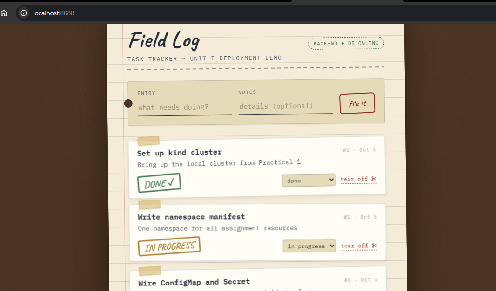

# DSO202 - Assignment 2: Unit II Advanced Kubernetes & Traffic Management

| Unit II topic | What changed from Assignment 1 | File(s) |
|---|---|---|
| **2.1 StatefulSets** | Database moved from `Deployment` + hand-made PVC to a `StatefulSet` + headless Service + `volumeClaimTemplates`, explicit PVC retention and a rollout `partition` | [database/statefulset.yaml](database/statefulset.yaml) |
| **2.2 Ingress** | `NodePort 30080` removed. One NGINX Ingress entry point with TLS termination, host + path routing, rewrite and rate-limit annotations | [ingress.yaml](ingress.yaml) |
| **2.3 RBAC** | One ServiceAccount per tier with no API access, plus three least-privilege personas (CI pipeline, developers, auditors) | [rbac.yaml](rbac.yaml), [operator/rbac.yaml](operator/rbac.yaml) |
| **2.4 Operators** | A working **TaskBackup Operator**: a CRD plus a kopf controller that reconciles each `TaskBackup` into a `pg_dump` Job and reports status | [operator/](operator/) |
| **2.5 Istio** | Sidecar injection, STRICT mTLS, default-deny AuthorizationPolicies, DestinationRules (circuit breaking) and VirtualServices (timeouts, retries); ingress controller joined to the mesh | [istio.yaml](istio.yaml), [ingress-nginx-istio-patch.yaml](ingress-nginx-istio-patch.yaml) |

---

## 1. Architecture

```text
 Browser  ── https://tasktracker.local ──►  ingress-nginx controller  (TLS terminated here: secret tasktracker-tls)
                                            │  + istio-proxy sidecar (mesh identity, mTLS out)
               ┌────────────────────────────┴──────────────────────────────┐
         path "/"  (Prefix)                                    path "/backend(/|$)(.*)"  rewrite → /$2
               ▼                                                           ▼
   frontend-svc:8080 (ClusterIP)                              backend-svc:8080 (ClusterIP)
   VirtualService: 5s timeout, 2 retries                      VirtualService: GET = 3 retries on 5xx,
   DestinationRule: outlier detection                         writes = retry only on connect-failure
               ▼                                              DestinationRule: subset v1, conn-pool, outlier detection
   frontend Pod [nginx | istio-proxy]                                      ▼
                                                              backend Pod [node api | istio-proxy]
                                                                           │  DB_HOST = db-0.db-headless
                                                                           ▼
                                                    db-headless (clusterIP: None) ─► db-0 [postgres | istio-proxy]
                                                                                        └─ PVC data-db-0 (1Gi, Retain)
   ─ ─ ─ ─ ─ ─ ─ ─ ─ ─ ─ ─ ─ ─ ─ ─ ─ ─ ─ ─ ─ ─ ─ ─ ─ ─ ─ ─ ─ ─ ─ ─ ─ ─ ─ ─ ─ ─ ─ ─ ─ ─ ─ ─ ─ ─ ─ ─ ─ ─ ─
   namespace taskbackup-operator                        namespace dso202-assignment-02
   taskbackup-operator Pod  ── watch TaskBackup ──►  TaskBackup nightly-001  ──creates──►  Job nightly-001-dump
   (kopf reconcile loop)     ◄── observe Job ──────  .status.phase=Succeeded                 └─ pg_dump → PVC task-backups

   PeerAuthentication STRICT + AuthorizationPolicy deny-all with per-tier allow rules: every hop is mTLS and identity-checked.
```

Every hop inside the namespace is encrypted twice over: once at the edge (browser → Ingress, TLS) and once in the mesh (Ingress sidecar → Pods, Istio mTLS). No Service is `NodePort` or `LoadBalancer`; the only way in is the Ingress.

### Design decisions

| Decision | Reason |
|---|---|
| Database is a **1-replica** StatefulSet | A StatefulSet gives `db-0` a stable name, DNS record and PVC. It does **not** make the stock postgres image replicate (§2.1.9, first pitfall). Three replicas would be three independent, empty databases. Real HA needs PostgreSQL-aware logic, i.e. a database Operator (§2.1.6). |
| Backend and frontend stay **Deployments** | Their replicas are interchangeable. A StatefulSet would add ordered, slower rollouts for no benefit (§2.1.9). |
| Ingress routes `/backend/*` **directly** to the backend | In Assignment 1 the frontend's own nginx proxied `/backend/*`. Now the Ingress does it at Layer 7, so the frontend runs its stock image config and the custom nginx ConfigMap is gone. |
| **Two** Ingress objects for one host | The regex/rewrite/rate-limit annotations must apply to the API only. Annotations are per-object (§2.2.5). |
| App ServiceAccounts have **no token and no bindings** | None of the three apps call the Kubernetes API. Least privilege means zero permissions (§2.3.2). |
| `backup` is an **Operator**, not a CronJob manifest | This demonstrates the CRD + controller pattern end to end (§2.4). Developers get a self-service `TaskBackup` API without needing permission to create Jobs or read Secrets. |

---

## 2. Repository layout

```text
assignment-2/
├── Makefile                          # make apply | verify | rbac-check | backup | cleanup
├── namespace.yaml                    # + istio-injection=enabled
├── configmap.yaml                    # DB_HOST=db-0.db-headless, CORS pinned to the Ingress host
├── secret.yaml
├── rbac.yaml                         # 2.3: SAs + ci-deployer / developer / auditor personas
├── database/statefulset.yaml         # 2.1: headless Service + StatefulSet "db"
├── backend/deployment.yaml           # Deployment + ClusterIP Service
├── frontend/deployment.yaml          # Deployment + ClusterIP Service
├── ingress.yaml                      # 2.2: TLS, host + path routing
├── istio.yaml                        # 2.5: mTLS, AuthorizationPolicies, DestinationRules, VirtualServices
├── ingress-nginx-istio-patch.yaml    # 2.5: joins the ingress controller to the mesh
└── operator/                         # 2.4: TaskBackup Operator
    ├── crd.yaml                      #   CustomResourceDefinition (schema, defaults, printer columns)
    ├── controller.py                 #   reconcile logic (kopf)
    ├── Dockerfile
    ├── rbac.yaml                     #   operator's own least-privilege identity
    ├── deployment.yaml
    └── sample-taskbackup.yaml        #   a Custom Resource
```

---

## 3. Prerequisites and deployment

| Requirement | Check |
|---|---|
| kind cluster `dso202` | `kubectl cluster-info --context kind-dso202` |
| NGINX Ingress Controller (kind provider manifest) | `kubectl get ingressclass nginx` |
| Istio 1.30 (`istio-base` + `istiod`, installed with Helm) | `helm list -n istio-system`, `kubectl get pods -n istio-system` |
| Docker + `openssl` | to build the operator image and the self-signed certificate |

```bash
# one-time platform setup
kubectl apply -f https://raw.githubusercontent.com/kubernetes/ingress-nginx/main/deploy/static/provider/kind/deploy.yaml
helm repo add istio https://istio-release.storage.googleapis.com/charts
helm install istio-base istio/base -n istio-system --create-namespace --version 1.30.5
helm install istiod istio/istiod -n istio-system --version 1.30.5 --wait
make ingress-mesh          # sidecar into ingress-nginx (needed for STRICT mTLS)

# the application, mesh policy and operator
make operator-image        # docker build + kind load
make apply                 # = make app istio operator
make verify
```


`make app` applies the manifests in dependency order (namespace → config/secret/RBAC → TLS secret → StatefulSet → Deployments → Ingress). It waits on each `rollout status`, because the backend's readiness probe needs `db-0` first.

**Reaching the app.** This kind cluster was created without `extraPortMappings`, so host ports 80/443 are not mapped (the same situation as Assignment 1). Port-forward the ingress controller and resolve the hostname locally:

```bash
kubectl port-forward -n ingress-nginx svc/ingress-nginx-controller 8443:443
# either add "127.0.0.1 tasktracker.local" to /etc/hosts and open https://tasktracker.local:8443
# or, without touching /etc/hosts:
curl -k --resolve tasktracker.local:8443:127.0.0.1 https://tasktracker.local:8443/backend/api/status
```


```text
{"status":"ok","db":"connected"}
```

<!-- evidence: screenshot of `kubectl get statefulset,deploy,pod,svc,pvc,ingress -n dso202-assignment-02` -->
<!-- evidence: screenshot of the Task Tracker UI at https://tasktracker.local:8443 -->

---

## 4. 2.1 StatefulSet: stable identity and storage

[database/statefulset.yaml](database/statefulset.yaml) pairs a headless Service `db-headless` (`clusterIP: None`) with StatefulSet `db` (`serviceName: db-headless`). Production-practice fields from §2.1.6 are all set explicitly: `podManagementPolicy: OrderedReady`, resource requests and limits, `updateStrategy.rollingUpdate.partition`, and `persistentVolumeClaimRetentionPolicy {whenDeleted: Retain, whenScaled: Retain}`.

The backend reaches the database at `db-0.db-headless`, the **per-Pod** DNS name that only a headless Service plus StatefulSet provides.

### 4.1 Stable name, DNS and PVC survive Pod deletion

```bash
export N=dso202-assignment-02
kubectl get pod,pvc -n $N -l tier=database
kubectl get pod db-0 -n $N -o jsonpath='{.spec.hostname}.{.spec.subdomain}{"\n"}'     # db-0.db-headless
kubectl get pod db-0 -n $N -o jsonpath='{.metadata.uid}{"\n"}'                        # note the UID
```


```
export N=dso202-assignment-02
kubectl delete pod db-0 -n $N
kubectl wait -n $N --for=condition=ready pod/db-0 --timeout=300s
kubectl get pod db-0 -n $N -o jsonpath='{.metadata.uid}{"  "}{.spec.volumes[?(@.name=="data")].persistentVolumeClaim.claimName}{"\n"}'
curl -sk --resolve tasktracker.local:8443:127.0.0.1 https://tasktracker.local:8443/backend/api/tasks
```


Expected: the new Pod has a **new UID** but the **same name** `db-0`, the same DNS name and the **same PVC** `data-db-0`. The tasks created before the deletion are still returned, so the data survived the Pod.

<!-- evidence: before/after UID + PVC + tasks still present -->

### 4.2 Canary rollout with `partition` (§2.1.8)

```bash
export N=dso202-assignment-02
kubectl patch statefulset db -n $N --type=json \
  -p='[{"op":"replace","path":"/spec/updateStrategy/rollingUpdate/partition","value":1}]'
kubectl patch statefulset db -n $N --type=merge \
  -p='{"spec":{"template":{"metadata":{"annotations":{"dso202/canary":"1"}}}}}'
kubectl get statefulset db -n $N -o jsonpath='{.status.currentRevision}{"  "}{.status.updateRevision}{"\n"}'
```


With `partition: 1`, only ordinals ≥ 1 receive the new template. `db-0` stays on `currentRevision` even though `updateRevision` has changed. Lowering the partition releases the rollout:

```bash
export N=dso202-assignment-02
kubectl patch statefulset db -n $N --type=json \
  -p='[{"op":"replace","path":"/spec/updateStrategy/rollingUpdate/partition","value":0}]'
kubectl rollout status statefulset/db -n $N
```


Forgetting this second step is §2.1.9's "half-applied rollout" pitfall. The committed manifest keeps `partition: 0`.

---

## 5. 2.2 Ingress and the Ingress controller

[ingress.yaml](ingress.yaml) selects the controller with `spec.ingressClassName: nginx`, not the deprecated annotation. It terminates TLS with `tasktracker-tls`, a `kubernetes.io/tls` Secret created by `make tls` with a self-signed certificate (CN/SAN `tasktracker.local`); the key is never committed. It then routes by host and path:

| Request | Ingress | pathType | Upstream |
|---|---|---|---|
| `https://tasktracker.local/` and everything else | `task-tracker-frontend` | `Prefix` | `frontend-svc:8080` |
| `https://tasktracker.local/backend/api/tasks` | `task-tracker-backend` | `ImplementationSpecific` (regex) | `backend-svc:8080/api/tasks` |

The backend rule needs a regex capture for `rewrite-target: /$2`, so it must use `ImplementationSpecific`. Its behaviour is controller-specific, as §2.2.5 warns. The API also gets a per-client rate limit (`limit-rps: 20`) that does not apply to static assets.

```bash
export N=dso202-assignment-02
kubectl get ingressclass
kubectl get ingress -n $N
kubectl describe ingress task-tracker-backend -n $N          # Backends column resolves to Pod endpoints
R="--resolve tasktracker.local:8443:127.0.0.1"
curl -sk $R -o /dev/null -w '%{http_code}\n' https://tasktracker.local:8443/                 # 200 (frontend)
curl -sk $R https://tasktracker.local:8443/config.js                                          # BACKEND_URL: "/backend"
curl -sk $R https://tasktracker.local:8443/backend/api/status                                 # {"status":"ok","db":"connected"}
curl -s  -o /dev/null -w '%{http_code} -> %{redirect_url}\n' -H 'Host: tasktracker.local' http://127.0.0.1:8080/   # 308 -> https (needs port-forward 8080:80)
curl -skv $R https://tasktracker.local:8443/ 2>&1 | grep 'subject:'                            # CN=tasktracker.local; O=DSO202
```




**Diagnosing a 502/503 (§2.2.8).** Check the chain from the Ingress outward: `kubectl describe ingress` (are backends resolved?), then `kubectl get endpoints backend-svc`, then Pod readiness, `kubectl describe pod` events and `kubectl logs --previous`. A resolved backend in `describe ingress` proves the Ingress object and controller are fine, so the fault is downstream.

<!-- evidence: kubectl get ingress, curl outputs, certificate subject -->

---

## 6. 2.3 RBAC: least privilege

[rbac.yaml](rbac.yaml) defines four kinds of subject. Nothing is granted by default; each grant is the minimum for its job.

| Subject | Binding → Role | Can | Cannot |
|---|---|---|---|
| `backend-sa`, `frontend-sa`, `db-sa`, `taskbackup-runner` | none (`automountServiceAccountToken: false`) | nothing. The apps never call the API; these accounts exist as distinct **mesh identities** for the Istio policies in §8 | anything |
| SA `ci-deployer` | RoleBinding → Role `task-tracker-ci-deployer` | `get/patch/update` **only** `deployments/backend`, `deployments/frontend`, `statefulsets/db`, `configmaps/task-tracker-config` (pinned with `resourceNames`); list/watch for `rollout status` | create or delete anything, Secrets, RBAC, other namespaces |
| Group `dso202-developers` | RoleBinding → Role `task-tracker-developer` | read workloads/logs/events, `exec`, `port-forward`, scale, `rollout restart`, full control of `TaskBackup`s | read **Secrets**, delete workloads, change RBAC |
| User `auditor@cst.edu.bt` | **RoleBinding** → built-in **ClusterRole** `view` | read-only in this namespace | anything in any other namespace; Secrets (`view` excludes them) |
| SA `taskbackup-operator` | Role in app namespace + small read-only ClusterRole | create Jobs, create the backup PVC, patch `TaskBackup` status | delete Jobs, read Secrets, touch Deployments |

Notes that connect back to §2.3:

- **`resourceNames` does not restrict `list`/`watch`/`create`.** Those verbs don't name one object, so they sit in a separate rule.
- **`patch` ≠ `update`.** `kubectl apply`, `rollout restart` and `kubectl patch` send PATCH, so the developer role grants `patch`.
- **`pods/exec` and `pods/portforward` are subresources** with the verb `create`. Granting `pods` alone does not allow `exec`.
- **A RoleBinding to a ClusterRole** reuses the cluster-wide definition but grants it only in the binding's namespace (the auditor).
- The operator needed `list/watch namespaces` cluster-wide because the kopf framework watches namespaces. This was found by **running it** and reading the `403 Forbidden` in its log, then adding exactly that rule. That is the least-privilege workflow in practice.

```bash
make rbac-check
```

Output on this cluster:

```text
no   list pods --as=system:serviceaccount:dso202-assignment-02:backend-sa
yes  patch deployment/backend --as=system:serviceaccount:dso202-assignment-02:ci-deployer
no   patch deployment/other --as=system:serviceaccount:dso202-assignment-02:ci-deployer
no   delete deployment/backend --as=system:serviceaccount:dso202-assignment-02:ci-deployer
yes  create pods --subresource=exec --as=dev@cst.edu.bt --as-group=dso202-developers
no   get secrets --as=dev@cst.edu.bt --as-group=dso202-developers
yes  create taskbackups.dso202.cst.edu.bt --as=dev@cst.edu.bt --as-group=dso202-developers
yes  list pods --as=auditor@cst.edu.bt
no   get secrets --as=auditor@cst.edu.bt
yes  create jobs --as=system:serviceaccount:taskbackup-operator:taskbackup-operator
no   delete jobs --as=system:serviceaccount:taskbackup-operator:taskbackup-operator
no   list pods --as=auditor@cst.edu.bt -n kube-system
```


Demonstrating an actual `Forbidden` with a real token (authentication vs authorization, §2.3.3):

```bash
export N=dso202-assignment-02
TOKEN=$(kubectl create token ci-deployer -n $N --duration=10m)
kubectl --token="$TOKEN" -n $N set image deployment/backend backend=sarojsanyasi/dso202-backend:1.0   # allowed
kubectl --token="$TOKEN" -n $N delete pod -l tier=frontend                                         # Forbidden
kubectl --token="$TOKEN" -n $N get secret task-tracker-secret                                     # Forbidden
```


The token authenticates successfully (the error names the ServiceAccount). The request is then **authorized** or refused by RBAC.

<!-- evidence: make rbac-check output, Forbidden messages -->

---

## 7. 2.4 Operators: the TaskBackup Operator

### 7.1 What it is

| Piece | Kubernetes concept | File |
|---|---|---|
| `TaskBackup` type, group `dso202.cst.edu.bt/v1alpha1`, short name `tb` | **CRD**: a new API noun, stored in etcd, served by the API server | [operator/crd.yaml](operator/crd.yaml) |
| `nightly-001` | **Custom Resource**: one instance of that noun (desired state) | [operator/sample-taskbackup.yaml](operator/sample-taskbackup.yaml) |
| `taskbackup-operator` Deployment | **Controller / Operator**: a reconcile loop that makes reality match the CR | [operator/controller.py](operator/controller.py), [operator/deployment.yaml](operator/deployment.yaml) |

The CRD uses the API server's own features rather than controller code wherever it can:

- **OpenAPI schema defaults.** A CR that says nothing gets `host: db-0.db-headless`, `port: 5432`, `name: taskdb`, `credentialsSecret: task-tracker-secret`, `pvcName: task-backups`.
- **Validation.** Port range, size pattern `^[0-9]+(Mi|Gi)$`, a `phase` enum, and a CEL rule `self == oldSelf` that makes a backup request immutable once created.
- **A `status` subresource.** Users write `spec`; only the controller writes `status`.
- **`additionalPrinterColumns`.** `kubectl get tb` shows Database / Phase / File / Age.

### 7.2 Reconciliation loop

```text
            watch (kopf informer + per-object queue)
TaskBackup ───────────────────────────────────────►  on.create handler
  spec                                                  1. ensure PVC task-backups exists (NOT owned: backups outlive the CR)
                                                        2. create Job <name>-dump, ownerReference → TaskBackup
                                                           (409 AlreadyExists tolerated, so a retried handler is idempotent)
                                                        3. status: phase=Running, jobName, backupFile, startedAt
                                                     timer every 5s  while phase ∈ {Pending, Running}
Job.status.conditions  ─── observe ─────────────────►   Complete → phase=Succeeded   Failed → phase=Failed + message
                                                        + Kubernetes Events on the TaskBackup
kubectl delete tb nightly-001  ─────────────────────►  ownerReference ⇒ garbage collector deletes the Job; the .sql file stays on the PVC
```

The backup Job reuses the database image (`sarojsanyasi/dso202-db:1.0`), so `pg_dump` matches the server version. It reads credentials through `secretKeyRef`, which means **neither the operator nor the requesting developer ever reads the Secret**. It waits with `pg_isready` before dumping. It runs inside the mesh (native Istio sidecar) as ServiceAccount `taskbackup-runner`, which is the only identity besides the backend that the database's AuthorizationPolicy admits. It mounts no API token.

### 7.3 Run it

```bash
export N=dso202-assignment-02
make operator-image && make operator
kubectl get crd taskbackups.dso202.cst.edu.bt
kubectl apply -f operator/sample-taskbackup.yaml
kubectl get tb -n $N -w
kubectl get tb nightly-001 -n $N -o yaml            # note the defaulted spec and the status block
kubectl get job,pod -n $N -l component=backup
kubectl logs -n $N job/nightly-001-dump -c pg-dump
kubectl describe tb nightly-001 -n $N               # Events: JobCreated, BackupSucceeded
kubectl logs -n taskbackup-operator deploy/taskbackup-operator
```

Output on this cluster:

```text
$ kubectl get tb -n dso202-assignment-02
NAME          DATABASE           PHASE       FILE                               AGE
nightly-001   db-0.db-headless   Succeeded   nightly-001-20260928T125904Z.sql   7m27s

$ kubectl logs -n dso202-assignment-02 job/nightly-001-dump -c pg-dump
db-0.db-headless:5432 - accepting connections
wrote /backups/nightly-001-20260928T125904Z.sql (2534 bytes)

$ kubectl describe tb nightly-001 -n dso202-assignment-02
Status:
  Backup File:   nightly-001-20260928T125904Z.sql
  Job Name:      nightly-001-dump
  Message:       pg_dump completed
  Phase:         Succeeded
Events:
  Normal  JobCreated       kopf  Started nightly-001-dump
  Normal  BackupSucceeded  kopf  Wrote nightly-001-20260928T125904Z.sql
```


The **failure path** was exercised as well. The first attempt, made before the `taskbackup-runner` fix in §8, ended with `Phase: Failed`, `Message: Job was active longer than specified deadline` and a `Warning BackupFailed` event. The controller reports failures as faithfully as successes. Deleting that `TaskBackup` garbage-collected its Job through the ownerReference, while the `task-backups` PVC was kept.

Immutability and validation are enforced by the API server itself:

```bash
export N=dso202-assignment-02
kubectl patch tb nightly-001 -n $N --type=merge -p '{"spec":{"database":{"name":"other"}}}'
# The TaskBackup "nightly-001" is invalid: spec: Invalid value: ... A TaskBackup is a one-shot request; create a new one instead of editing it.
kubectl apply -f - <<'EOF'
apiVersion: dso202.cst.edu.bt/v1alpha1
kind: TaskBackup
metadata: {name: bad, namespace: dso202-assignment-02}
spec: {storage: {size: "lots"}}
EOF
# spec.storage.size: Invalid value: "lots": spec.storage.size in body should match '^[0-9]+(Mi|Gi)$'
```


<!-- evidence: kubectl get tb (Succeeded), job logs, describe events, operator logs -->

---

## 8. 2.5 Service mesh with Istio

| Object | Purpose |
|---|---|
| namespace label `istio-injection=enabled` | istiod's mutating webhook injects `istio-proxy` into every Pod, which is why Pods show `2/2` |
| `PeerAuthentication default` `mode: STRICT` | every workload **only** accepts mTLS. Plain-text clients are refused |
| `DestinationRule backend` | subset `v1` (by `version` label), `ISTIO_MUTUAL`, connection-pool limits, **outlier detection** (eject a Pod after 3 consecutive 5xx for 30s) |
| `VirtualService backend` | GET: 6s timeout, 3 retries on `5xx,reset,connect-failure`. **Writes: retry only on `connect-failure,refused-stream`**, so a POST that reached the app is never duplicated |
| `DestinationRule`/`VirtualService frontend` | mTLS, 5s timeout, 2 retries, outlier detection |
| `AuthorizationPolicy deny-all` (empty spec) | **default deny** for every workload in the namespace |
| `frontend-allow-ingress` / `backend-allow-ingress` | only the ingress controller's identity `cluster.local/ns/ingress-nginx/sa/ingress-nginx` may call them. The backend admits only the real API methods and paths |
| `db-allow-backend-and-backups` | Postgres (L4, port 5432) admits only `backend-sa` and `taskbackup-runner`, the Operator's backup Jobs |
| [ingress-nginx-istio-patch.yaml](ingress-nginx-istio-patch.yaml) | gives the ingress controller a sidecar (outbound only) so that it can reach a STRICT namespace. Combined with `service-upstream` + `upstream-vhost` in [ingress.yaml](ingress.yaml), nginx sends to the Service, so the VirtualService rules apply to edge traffic too |

Service port names `http` and `tcp-postgres` tell Istio which protocol to expect: L7 HTTP policy for the API, opaque TCP for Postgres.

```bash
export N=dso202-assignment-02
kubectl get pods -n $N                                        # READY 2/2
kubectl get peerauthentication,destinationrule,virtualservice,authorizationpolicy -n $N

# 1) Outside the mesh (no sidecar, no certificate): refused at the TLS layer by STRICT mTLS
kubectl run plain-client -n default --restart=Never --image=sarojsanyasi/dso202-db:1.0 --command -- \
  sh -c 'wget -qO- -T 5 http://backend-svc.dso202-assignment-02:8080/api/status'
kubectl logs plain-client -n default          # wget: error getting response: Connection reset by peer
kubectl delete pod plain-client -n default

# 2) Inside the mesh, valid mTLS, but the wrong identity: refused by AuthorizationPolicy
kubectl exec -n $N deploy/frontend -c frontend -- wget -qO- -T 5 http://backend-svc:8080/api/status
                                              # wget: server returned error: HTTP/1.1 403 Forbidden

# 3) The allowed identity (ingress-nginx), via the Ingress: accepted
curl -sk --resolve tasktracker.local:8443:127.0.0.1 https://tasktracker.local:8443/backend/api/status
                                              # {"status":"ok","db":"connected"}
```


These three results separate the two layers. **Authentication** (mTLS, PeerAuthentication) rejects the first client before HTTP exists: a connection reset. **Authorization** (AuthorizationPolicy) rejects the second client *after* identifying it: an HTTP 403 generated by the backend's own sidecar. This mirrors the RBAC distinction in §2.3: 401 is "who are you?", and 403 is "I know who you are, and no".

The same policy caught a real bug during this assignment. The first backup Job ran as the `default` ServiceAccount, and `pg_dump` failed with `server closed the connection unexpectedly`. The database's sidecar was refusing an identity not on its allow-list. The fix was a dedicated `taskbackup-runner` ServiceAccount for backup Jobs, not a wider policy.

<!-- evidence: 2/2 pods, mesh objects, plain-text refused vs in-mesh success -->

---

## 9. Verification summary and cleanup

```bash
make verify        # workloads, mesh objects, TaskBackups, end-to-end curl
make rbac-check    # RBAC truth table
make cleanup       # removes operator, CRD and namespace (PVCs go with the namespace)
```


> **Environment note.** The kind node runs inside Docker Desktop's VM with ~1.7 GiB of memory. Under that pressure `kube-controller-manager` and `kube-scheduler` restart repeatedly (visible in `kubectl get pods -n kube-system`). When that happens, Jobs, rollouts and ReplicaSets pause until they recover. Raising Docker Desktop's memory to 4 GiB or more avoids it.

---

## 10. Review answers

**2.1 StatefulSets**
1. `cache-0`, `cache-1`, `cache-2`. If `cache-1` is deleted, the recreated Pod is again named `cache-1` and is re-attached to the **same** PVC `<template>-cache-1`. It does not get a new empty volume.
2. A ClusterIP Service gives one virtual IP and load-balances, so a peer cannot address a *specific* replica. A headless Service makes DNS return each Pod's IP and, with `serviceName`, creates per-Pod records such as `db-0.db-headless`. This assignment's backend depends on that exact name.
3. With `partition: 1` on 5 replicas, ordinals 1–4 are updated (in descending order: 4, 3, 2, 1). Ordinal 0 stays on the old revision until the partition is lowered.

**2.2 Ingress**
1. The request reaches the ingress-nginx Pod, TLS is terminated with `tasktracker-tls`, and the Host header matches `tasktracker.local`. The path `/backend/api/tasks` matches the regex rule and is rewritten to `/api/tasks`. nginx forwards to `backend-svc` (through its sidecar with mTLS). kube-proxy and Envoy pick a ready endpoint, and the container receives plain HTTP on 8080.
2. (a) No Ingress controller is running, so nothing watches the object. (b) `ingressClassName` names a class no controller serves. In both cases no listener exists, so the client sees a connection error rather than a 404, which only a running controller could return.
3. `describe ingress` showing a resolved endpoint IP proves the controller has read the Ingress and mapped it to a live Service endpoint. The routing layer is therefore working, and a 502 means the upstream failed, so the investigation moves to endpoints and Pod health.

**2.3 RBAC**
1. A RoleBinding in `staging` that references a ClusterRole grants those permissions only in `staging`. It grants nothing in `production`.
2. Authentication establishes *who* (certificate, token, ServiceAccount). Authorization (RBAC) decides *whether that identity may do this*. A `Forbidden` response means authentication succeeded and no rule matched.
3. `update` and `patch` are distinct verbs. `kubectl apply` on an existing object sends a PATCH, so a role with only `update` rejects it.

**2.4 Operators**
1. A CRD alone only lets the API server store and serve the new type. Without a controller, a `TaskBackup` is just data and no Job is ever created. The Operator is the running controller that reconciles it.
2. Reconciliation is level-based: the controller compares desired and observed state every time rather than replaying events. If the operator restarts mid-backup, the timer re-reads the Job and still reports the right phase. Create is idempotent (409 tolerated).
3. `ownerReferences` hand clean-up to the Kubernetes garbage collector. The backup PVC is deliberately *not* owned, so deleting a request never deletes backups.

**2.5 Istio**
1. Data plane: the `istio-proxy` sidecars that carry every request. Control plane: `istiod`, which pushes config and certificates to them and never touches traffic.
2. A VirtualService decides *where* a request goes and with what timeout and retries. A DestinationRule decides *how* to talk to the chosen destination (TLS, pool limits, outlier detection, subsets).
3. Retrying a non-idempotent POST after the app received it can create duplicates. Writes here therefore retry only on `connect-failure`/`refused-stream`, where the request provably never arrived.
